<h1 align="center">Amazon Marketplace Sales Performance Report</h1>
<p align="center"><em>2021–2025 · R · tidyverse · ggplot2 · R Markdown</em></p>

<table align="center">
  <tr>
    <td width="1440">
      <h2 align="center">Client Background</h2>
      The client is a <strong>US-based online marketplace</strong> that sells across nine categories, from Electronics and Home &amp; Kitchen to Beauty, Grocery and Pet Supplies. Products are sold by the platform itself (first-party, 1P) and by more than <strong>250</strong> independent marketplace sellers (3P). Over the last five years the business has added a Prime-style membership program, expanded into <strong>Canada, the UK and Germany</strong>, and opened new fulfilment centres.<br>
      <br>
      The business has served over <strong>42,000</strong> customers through about <strong>85,000</strong> orders and <strong>203,000</strong> order lines, generating <strong>$20.6 million</strong> in net revenue. The data spans sales, products, sellers, customers, payments, marketing, shipments, inventory, returns and reviews.<br>
      <br>
      I analysed performance from 2021 to 2025 to explain what drove growth, why targets were missed in some years, and where the business should focus next. The analysis focuses on these areas:
      <h3>Northstar Metrics</h3>
      <ul>
        <li><strong>Sales trends:</strong> revenue, number of orders, average order value (AOV) and performance against target.</li>
        <li><strong>Product performance:</strong> category mix, top products and the split between 1P and marketplace sellers.</li>
        <li><strong>Customers and loyalty:</strong> repeat purchasing, cohort retention, Prime membership and customer value segments.</li>
        <li><strong>Marketing:</strong> channel mix, return on ad spend (ROAS), customer acquisition cost (CAC) and campaign ROI.</li>
        <li><strong>Fulfilment and returns:</strong> delivery speed, late deliveries, stockouts, return rates and customer ratings.</li>
      </ul>
    </td>
  </tr>
</table>

<h1 align="center">Executive Summary</h1>
<h3 align="center">Sales Revenue Analysis (2021–2025)</h3>
<div align="center">
  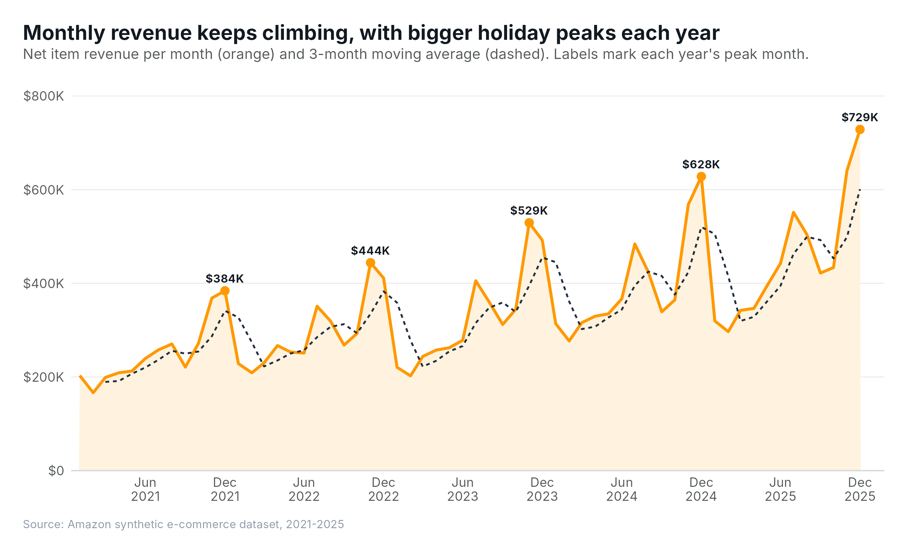
</div>
<table align="center">
  <tr>
    <td width="460" valign="top">
      <ol>
        <li>
          <strong>Revenue Growth</strong>
          <ul>
            <li>Net revenue grew from <strong>$3.0M in 2021 to $5.4M in 2025</strong>, a compound annual growth rate of about 16%.</li>
            <li>Growth was uneven: <strong>+21% in 2024</strong> was the best year, and <strong>+11% in 2023</strong> the weakest, after a soft first half.</li>
            <li>December 2025 was the best month on record at <strong>$729K</strong>.</li>
          </ul>
        </li>
        <li>
          <strong>Targets Missed in 2022 and 2023</strong>
          <ul>
            <li>Revenue reached only <strong>90% and 91% of target</strong> in 2022 and 2023.</li>
            <li>In 2022 the cause was operational: late deliveries reached 34%, stockouts peaked at 28% of products and returns rose to 11.8% of order lines.</li>
          </ul>
        </li>
      </ol>
    </td>
    <td width="460" valign="top">
      <ol start="3">
        <li>
          <strong>Seasonality</strong>
          <ul>
            <li>November and December bring about <strong>25% of annual revenue</strong>. Black Friday sells about 4.5x a normal day.</li>
            <li>July became a second peak thanks to the summer Mega Deal Days event (3.3x a normal day). February is the weakest month every year.</li>
          </ul>
        </li>
        <li>
          <strong>Key Takeaways &amp; Recommendations</strong>
          <ul>
            <li>Protect delivery performance in peak season, because the 2022 slowdown hurt ratings, returns, retention and sales at the same time.</li>
            <li>Shift investment towards the fast-growing everyday categories and toward loyal customers.</li>
            <li>Cut deep discounts on flagship campaigns that lose money.</li>
          </ul>
        </li>
      </ol>
    </td>
  </tr>
</table>

<h2 align="center">Dataset Structure and ERD (Entity Relationship Diagram)</h2>
The database has <strong>16 tables</strong> with about <strong>680,000 rows</strong> in total. <code>order_items</code> (203,097 rows) is the central fact table. It links to orders, customers, payments, shipments and campaigns on one side, and to products, categories, sellers and inventory on the other.
<div align="center">
  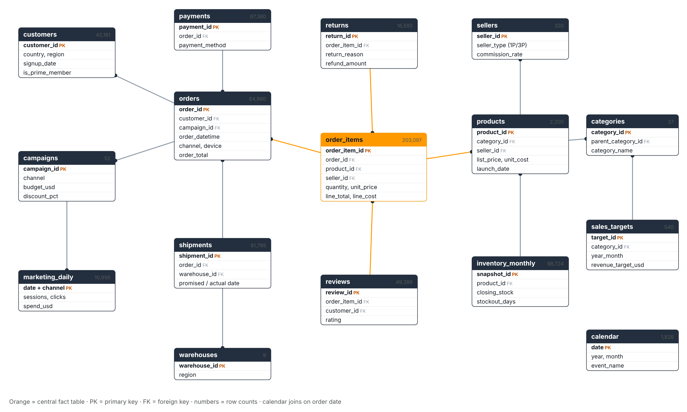
</div>

<h1 align="center">Insights Deep-Dive</h1>

<h1 align="center">Sales Trend</h1>
<table align="center">
  <tr>
    <td width="1000">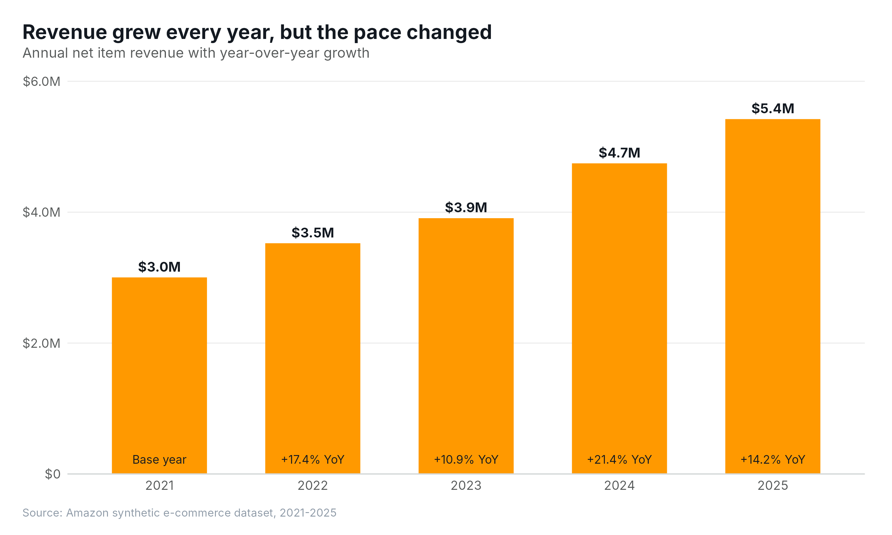</td>
    <td width="1000">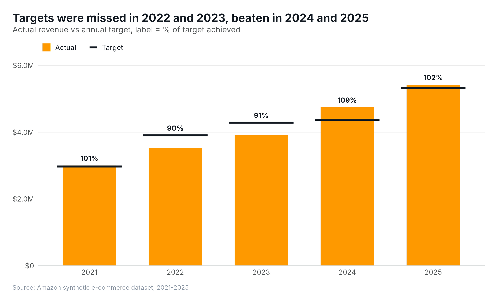</td>
    <td width="1000">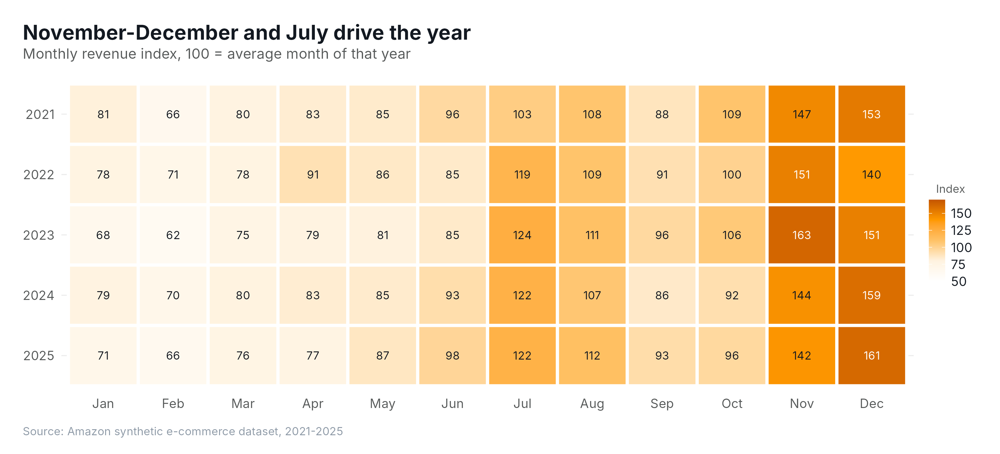</td>
  </tr>
</table>
<table>
  <tr>
    <td>
      <strong>Sales Revenue</strong>
      <ol>
        <li>Steady Growth, Uneven Pace
          <ul>
            <li>Revenue grew every year: +17% (2022), +11% (2023), +21% (2024) and +14% (2025).</li>
            <li>Each year's peak month is higher than the last: $384K (Dec 2021), $444K (Nov 2022), $529K (Nov 2023), $628K (Dec 2024) and <strong>$729K (Dec 2025)</strong>.</li>
          </ul>
        </li>
        <li>2022 – Growth Without Profit
          <ul>
            <li>Orders grew 21% in 2022, but prices rose about 8% and customers bought smaller baskets, so <strong>AOV fell 2.6%</strong>.</li>
            <li>Targets assumed 30% growth. Actual growth was 17%, leaving revenue at 90% of plan.</li>
          </ul>
        </li>
        <li>2023 – Soft First Half
          <ul>
            <li>Demand dropped from January to May 2023. Orders grew only 5%, and the number of active customers <strong>fell 5.6%</strong>.</li>
            <li>Growth came from bigger baskets instead: AOV rose 5.4% to $254.</li>
          </ul>
        </li>
      </ol>
      <strong>Average Order Value</strong>
      <ol>
        <li>AOV dipped to <strong>$241 in 2022</strong> and recovered to <strong>$257 in 2025</strong>.</li>
        <li>Since 2023 AOV has been almost flat (+0.5% a year), so recent growth is driven by <strong>more orders</strong>, not bigger baskets.</li>
      </ol>
      <strong>Order Count and Margin</strong>
      <ol>
        <li>Orders rose from 12,133 in 2021 to <strong>21,105 in 2025 (+74%)</strong>, faster than active customers (+54%). Each customer now orders more often: 1.75 orders a year, up from 1.55.</li>
        <li>Gross margin slipped from 36.4% to 35.0%, because supplier costs rose slightly faster than selling prices.</li>
      </ol>
    </td>
  </tr>
</table>
<div align="center">
  <h4>Orders and customers grow every year except 2023, while AOV and margin move in a narrow range</h4>
  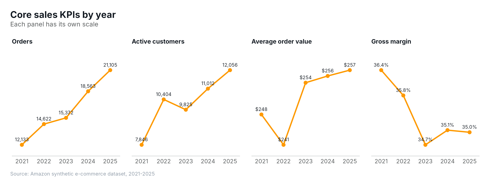
</div>

<h1 align="center">Product Performance</h1>
<div align="center">
  <h3>Electronics Loses Share as Everyday Categories Grow</h3>
  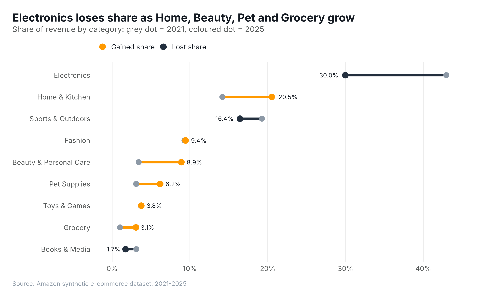
</div>
<table align="center">
  <tr>
    <td width="333" valign="top">
      <h3>Category Mix</h3>
      <ul>
        <li>Electronics is still the largest category, but its share fell from <strong>43.0% to 30.0%</strong> of revenue.</li>
        <li>Home &amp; Kitchen gained the most share (+6.3 pp to 20.5%). Beauty, Pet Supplies and Grocery more than doubled their share.</li>
        <li>In 2025 <strong>Grocery grew 47%</strong>, Pet Supplies 33% and Beauty 32%. Toys &amp; Games (-3.9%) and Books &amp; Media (-4.1%) declined.</li>
      </ul>
    </td>
    <td width="333" valign="top">
      <h3>Best Sellers</h3>
      <ul>
        <li>The top product (#1422, Computers &amp; Tablets) generated <strong>$546K</strong> over five years, followed by #2052 in Outdoor Recreation ($538K).</li>
        <li>The top 10 products bring 13% of total revenue, and <strong>21% of products generate 80%</strong> of revenue.</li>
        <li>Several top Electronics products have return rates of 16–28%, which reduces their real value.</li>
      </ul>
    </td>
    <td width="333" valign="top">
      <h3>Marketplace Sellers</h3>
      <ul>
        <li>Marketplace (3P) sellers generated <strong>67% of revenue</strong> in 2025, up from 62% in 2021.</li>
        <li>The number of active 3P sellers grew from 168 to 258.</li>
        <li>Seller commission brought in <strong>$469K</strong> in 2025, up from $249K in 2021.</li>
      </ul>
    </td>
  </tr>
</table>
<table align="center">
  <tr align="center">
    <td width="1000" valign="top">
      <h3>Category Growth in 2025</h3>
      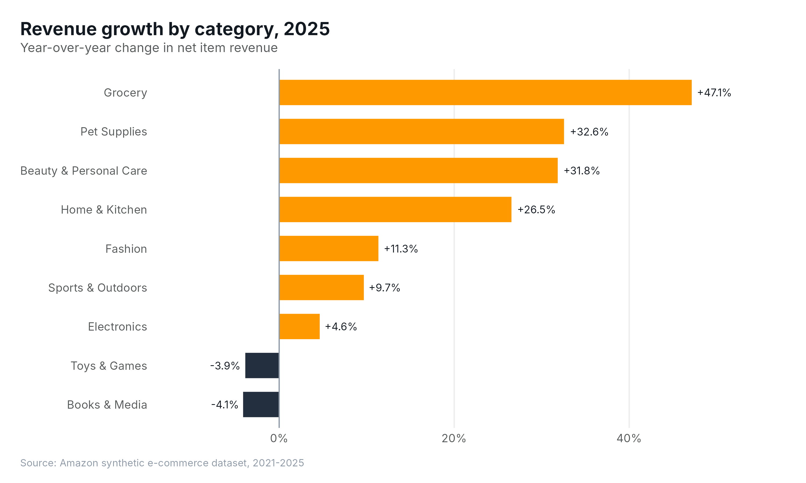
    </td>
    <td width="1000" valign="top">
      <h3>Top 10 Products by Revenue</h3>
      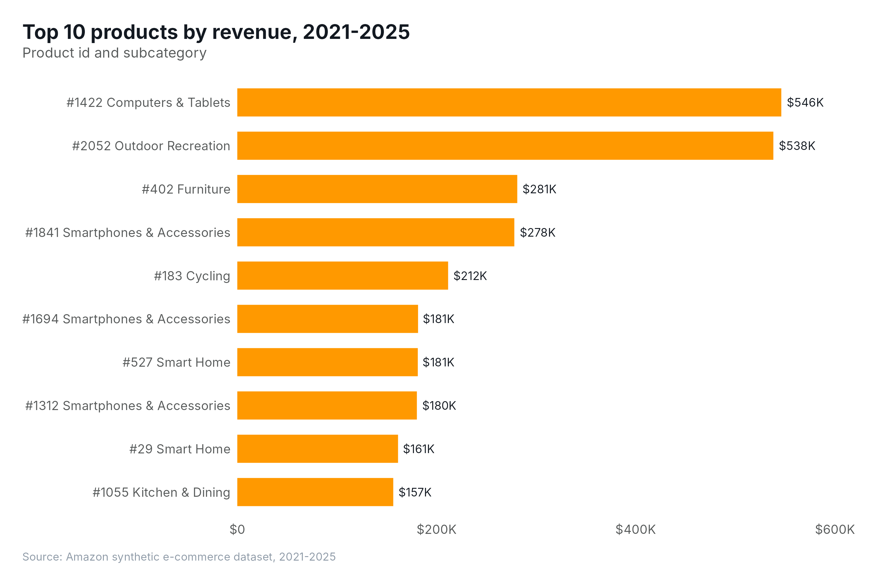
    </td>
  </tr>
</table>

<h1 align="center">Customers and Prime Membership</h1>
<table align="center">
  <tr align="center">
    <td width="1000">
      <h3>New vs Returning Customer Revenue</h3>
      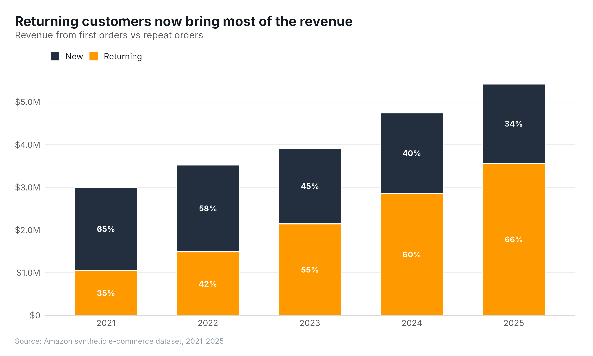
    </td>
    <td width="1000">
      <h3>Customer Retention by Cohort</h3>
      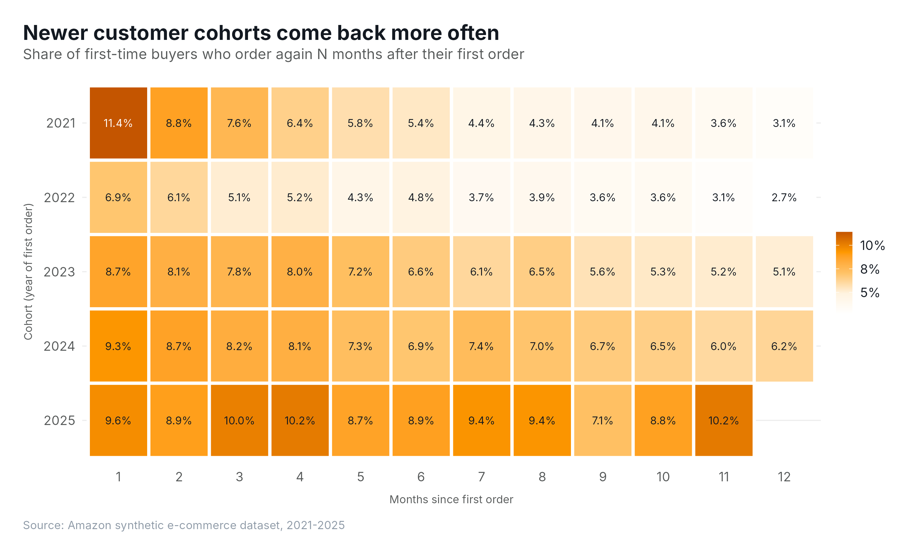
    </td>
  </tr>
</table>
<table>
  <tr>
    <td>
      <ul>
        <li>Returning customers placed <strong>65% of orders in 2025</strong>, up from 35% in 2021. New-customer numbers have stayed around 7,500 a year since 2022, so growth now comes from existing customers buying more often.</li>
        <li>Customers acquired in 2022 were the least loyal: only <strong>2.7%</strong> still ordered 12 months later, because their first experience came during the delivery crunch. The 2024 cohort reached <strong>6.2%</strong>, and the 2025 cohort is on track to beat it.</li>
        <li>Prime orders rose from <strong>9% of orders in 2021 to 41% in 2025</strong>, with the biggest jump after the 2023 loyalty push. In 2025 Prime orders were 5% larger than non-Prime orders ($265 vs $252).</li>
        <li>RFM segmentation shows that <strong>Champions are 9% of customers but bring 28% of revenue</strong>. At Risk customers, who used to buy often but have gone quiet, are 5% of customers and 10% of revenue.</li>
      </ul>
    </td>
  </tr>
</table>
<div align="center">
  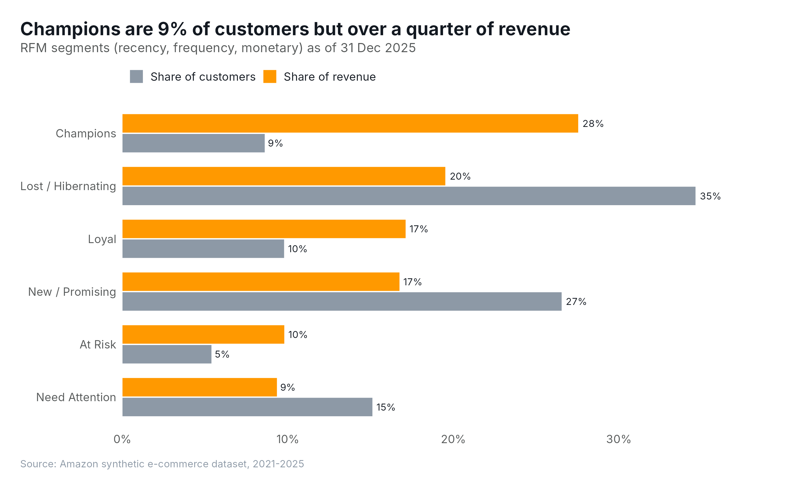
</div>

<h1 align="center">Marketing and Channels</h1>
<table align="center">
  <tr align="center">
    <td width="1000">
      <h3>Revenue Share by Channel</h3>
      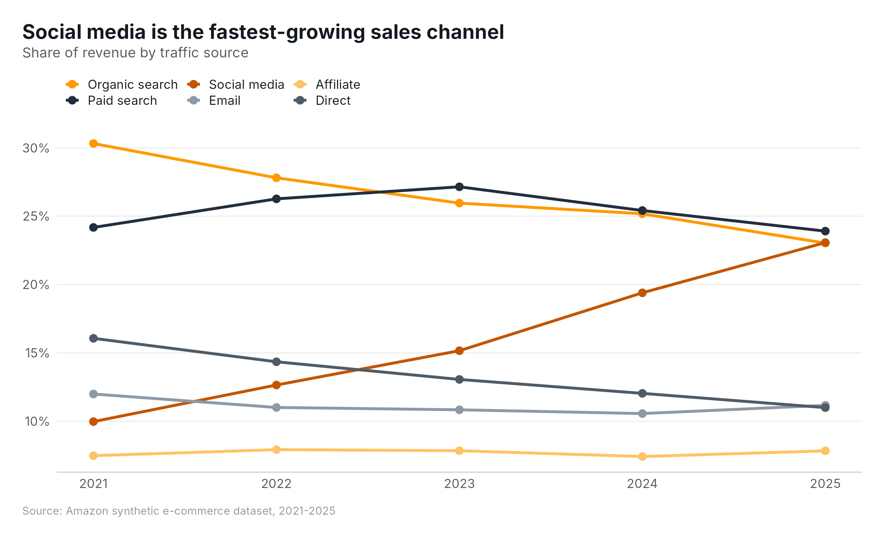
    </td>
    <td width="1000">
      <h3>Paid Media Efficiency</h3>
      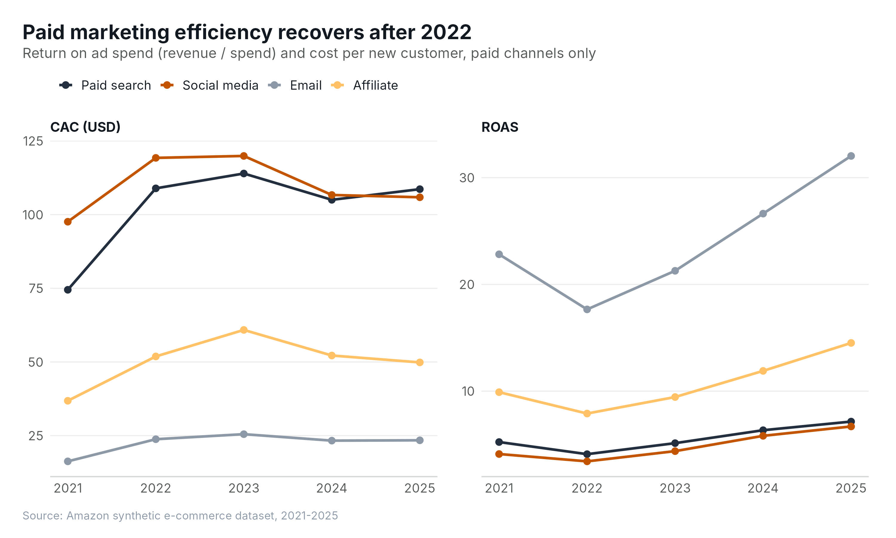
    </td>
  </tr>
</table>
<table>
  <tr>
    <td valign="top" width="500">
      <ul>
        <li><strong>Social media grew from 10% to 23% of revenue</strong> and now matches paid and organic search. Organic search fell from 30% to 23%, so the business depends more on paid traffic.</li>
        <li>Overall ROAS fell to <strong>8.5x in 2022</strong>, when ad costs rose and conversion dropped, and recovered to <strong>13.0x in 2025</strong>.</li>
        <li>Email is the most efficient channel, with ROAS of 32x. Paid search and social cost about <strong>$107 per new customer</strong>.</li>
      </ul>
    </td>
    <td valign="top" width="500">
      <ul>
        <li><strong>7 of 11 campaign types lost money</strong> once discounts were counted. Back to School was the clear winner with <strong>149% ROI</strong>.</li>
        <li>Flagship events (Black Friday Week, Mega Deal Days) drive the biggest sales days but lose 50–66% of their budget at current discount levels.</li>
        <li>The mobile app's share of orders grew from 18% to 34%. Digital wallets and buy-now-pay-later grew from 15% to 37% of payments.</li>
      </ul>
    </td>
  </tr>
</table>
<div align="center">
  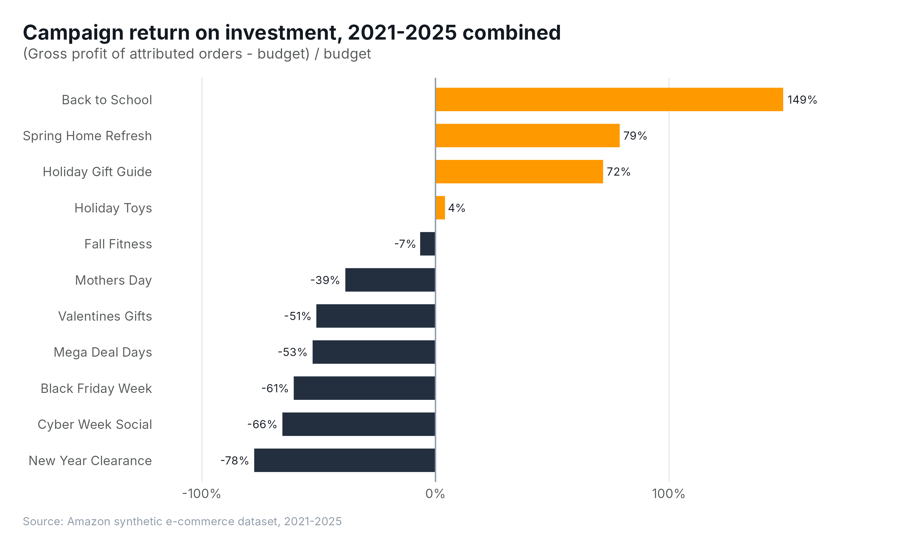
</div>

<h1 align="center">Fulfilment, Returns and Ratings</h1>
<table align="center">
  <tr>
    <td width="500">
      <div align="center">
        <h3>Return Rate by Category</h3>
        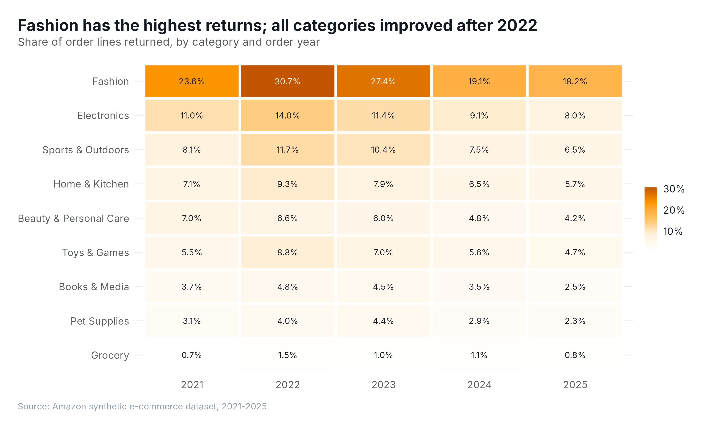
      </div>
    </td>
    <td valign="top" width="500">
      <ul>
        <li><strong>Fashion has by far the highest return rate</strong>, peaking at 30.7% in 2022. "Wrong size or fit" accounts for 48% of Fashion returns.</li>
        <li>After the stricter return policy in 2024, Fashion returns fell to 18.2%, and the overall return rate dropped from 11.8% (2022) to <strong>6.2% (2025)</strong>.</li>
        <li>Grocery and Pet Supplies have the lowest return rates, at 1–4%.</li>
        <li>Across all categories, the top return reasons are defective or damaged items (23%) and items not as described (20%).</li>
      </ul>
    </td>
  </tr>
</table>
<table align="center">
  <tr align="center">
    <td width="1000">
      <h3>Late Deliveries by Carrier</h3>
      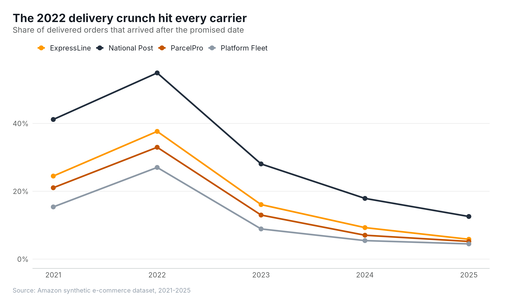
    </td>
    <td width="1000">
      <h3>Ratings: Late vs On-Time Deliveries</h3>
      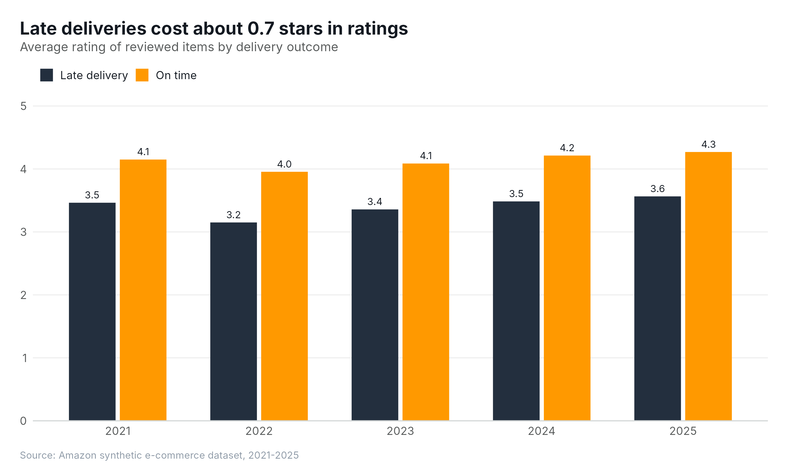
    </td>
  </tr>
</table>
<table>
  <tr>
    <td>
      <ul>
        <li>Average delivery time rose to <strong>5.1 days in 2022</strong> and fell to <strong>2.8 days in 2025</strong> after new warehouses opened and next-day shipping expanded.</li>
        <li>The late-delivery rate peaked at 34% in 2022. National Post was the worst carrier that year, with 55% of its orders late. In 2025 the rate was 5.5%, and Platform Fleet was the most reliable carrier at 4.5%.</li>
        <li>Late items are rated <strong>about 0.7 stars lower</strong> than items that arrive on time, every year. The average rating fell to 3.72 in 2022 and recovered to <strong>4.22 in 2025</strong>.</li>
      </ul>
    </td>
  </tr>
</table>

<h1 align="center">Regional Results</h1>
<div align="center">
  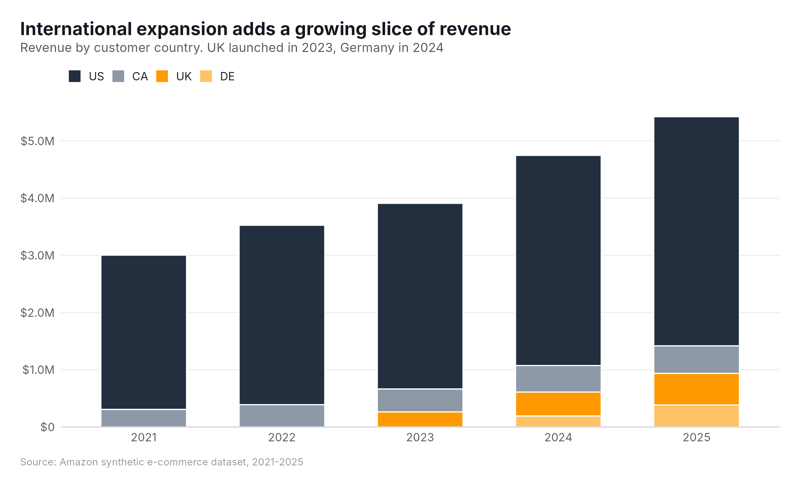
</div>
<table align="center">
  <tr valign="top">
    <td width="900">
      <ul>
        <li>The US is the core market, bringing in <strong>$4.0M (74%)</strong> of 2025 revenue.</li>
        <li>International markets grew from 10% to <strong>26% of revenue</strong>:
          <ul>
            <li>Canada: $481K in 2025.</li>
            <li>UK (launched 2023): $552K in 2025, about double its first year ($264K).</li>
            <li>Germany (launched 2024): $385K in 2025, double its first year ($192K).</li>
          </ul>
        </li>
        <li>The new markets added growth just as US growth slowed to about 9% a year.</li>
      </ul>
    </td>
  </tr>
</table>

<h1>Recommendations</h1>
<h4>Based on these insights, here are actions the business can take.</h4>
<ul>
  <h3>Sales</h3>
  <li>Protect peak-season delivery capacity in November and December.
    <ul>
      <li>November and December bring about 25% of annual revenue.</li>
      <li>In 2022, slow deliveries cut ratings and retention and contributed to missing the target (90% of plan).</li>
    </ul>
  </li>
  <li>Set targets based on order trends instead of fixed growth assumptions.
    <ul>
      <li>2022 and 2023 targets assumed 22–30% growth. Actual growth was 11–17%.</li>
    </ul>
  </li>
  <h3>Products</h3>
  <li>Grow the everyday categories and keep their best sellers in stock.
    <ul>
      <li>Grocery (+47%), Pet Supplies (+33%) and Beauty (+32%) were the fastest-growing categories in 2025, and they sell steadily all year.</li>
      <li>21% of products generate 80% of revenue, so stockouts on these items cost the most.</li>
    </ul>
  </li>
  <li>Review the Electronics assortment and pricing.
    <ul>
      <li>Electronics share fell from 43% to 30%, and several top Electronics products have return rates above 15%.</li>
    </ul>
  </li>
  <h3>Customers and Loyalty</h3>
  <li>Keep pushing Prime membership.
    <ul>
      <li>Prime orders rose from 9% to 41% of all orders, and Prime baskets are 5% larger.</li>
    </ul>
  </li>
  <li>Launch a win-back campaign for At Risk customers.
    <ul>
      <li>They are 5% of customers but 10% of revenue, and they used to buy often.</li>
    </ul>
  </li>
  <h3>Marketing</h3>
  <li>Reduce discount depth on flagship events and move budget to campaigns that pay off.
    <ul>
      <li>7 of 11 campaign types lost money. Back to School returned 149%.</li>
    </ul>
  </li>
  <li>Grow email and owned channels to reduce dependence on paid traffic.
    <ul>
      <li>Email ROAS is 32x, compared with about 7x for paid search and social.</li>
    </ul>
  </li>
  <h3>Fulfilment and Returns</h3>
  <li>Improve size guidance and fit information for Fashion.
    <ul>
      <li>"Wrong size or fit" accounts for 48% of Fashion returns.</li>
    </ul>
  </li>
  <li>Shift volume away from the slowest carrier.
    <ul>
      <li>National Post is consistently the latest carrier, and late items lose about 0.7 stars in ratings.</li>
    </ul>
  </li>
  <h3>Regions</h3>
  <li>Keep investing in the UK and Germany.
    <ul>
      <li>UK revenue doubled within two years of launch, Germany's doubled in its second year, and international revenue is now 26% of the total.</li>
    </ul>
  </li>
</ul>

<h1>Technical Details</h1>

<h3>Pipeline</h3>

| Step | Script | What it does |
|---|---|---|
| 0 | `00_theme.R` | Chart style: white, orange and black palette, ggplot2 theme, number formats |
| 1 | `01_load.R` | Imports the 16 CSVs with column types, checks primary and foreign keys |
| 2 | `02_clean.R` | Standardises text and factors, adds date fields, validates amounts, logs cleaning rules |
| 3 | `03_transform.R` | Builds 24 analysis tables: KPIs, categories, products, RFM, cohorts, channels, campaigns, logistics |
| 4 | `04_explore.R` | Exploratory analysis in 8 sections, exports summary tables to CSV |
| 5 | `05_visualize.R` | Creates 28 charts at 300 dpi |
| 6 | `06_dashboard.Rmd` | Five-page HTML dashboard with KPI cards and a written result under every chart |
| 7 | `07_run_all.R` | Runs the whole pipeline in order, with timing and error handling |

<h3>Dashboard</h3>

`06_dashboard.html` is a static HTML file (no Shiny, no server). A navigation menu switches between five pages: Sales overview, Products &amp; categories, Customers, Marketing &amp; channels, and Fulfilment &amp; quality.

<div align="center">
  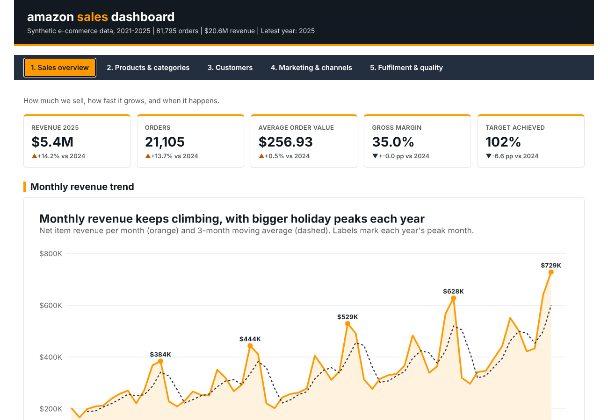
</div>

<h3>How to run</h3>

1. Clone the repository and open the folder in RStudio.
2. Set the working directory to the project folder (Session > Set Working Directory > To Source File Location).
3. Run `source("07_run_all.R")`. It takes about one minute.
4. Open `06_dashboard.html` in a browser.

Missing packages are installed automatically. Requirements: R 4.1 or later, with `readr`, `dplyr`, `tidyr`, `purrr`, `tibble`, `lubridate`, `stringr`, `forcats`, `ggplot2`, `scales`, `htmltools`, `rmarkdown` and `knitr`.

<h3>Project structure</h3>

```
Amazon/
├── Data/                 # 16 raw CSV tables
├── Output/               # generated by the pipeline (not tracked)
├── images/               # charts and screenshots used in this README
├── 00_theme.R … 05_visualize.R
├── 06_dashboard.Rmd
├── 06_dashboard.html
├── 07_run_all.R
└── README.md
```

<h3>Author</h3>


<strong>Algirdas Vailionis</strong>, Data Scientist · <a href="https://www.linkedin.com/in/algirdas-vailionis/">LinkedIn</a> · <a href="mailto:algirdas.vailionis@gmail.com">Email</a>

